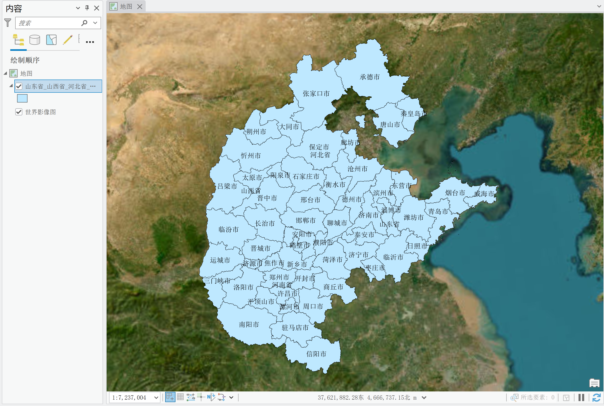

# chinaboundary

中国行政区边界数据获取工具：从阿里云 **DataV.GeoAtlas** 按需获取**国 / 省 / 市 / 区县**四级行政区边界，输出 **GeoJSON / GeoPackage / Shapefile**，坐标系为 **WGS-84**。



## 特性

- **四级层级 + 多级下钻**：国（无需选名称，固定返回中国范围矢量）、省、市、区县；`depth` 参数支持递归下钻多级（如输入省一次拿到市 + 区县）。
- **名称 / adcode 双入口**：可用行政区名称（如「广东省」「天河区」）或 6 位 adcode（如 `440000`、`440106`）；名称解析内置**精确 / 去后缀 / 前缀**三级匹配与**重名歧义提示**。
- **一次多目标**：`name` / `adcode` 均支持**逗号分隔多个值**（如 `name: 山东省,河北省`、`adcode: 370000,130000`），一次运行抓取多个行政区边界并合并输出。

- **三格式输出**：GeoJSON（零依赖）原生支持，GeoPackage / Shapefile 走可选 `geopandas`，缺包时告警跳过、不影响其他格式。
- **坐标系**：源数据即 WGS-84，直接原样输出，无任何转换。
- **本地缓存 + 断点友好**：原始响应按 URL 落盘缓存（带 TTL），名称↔adcode 字典一次构建长期复用，避免重复请求。
- **轻依赖**：核心仅 `requests` / `PyYAML` / `shapely` 三个包；gpkg/shp 导出走可选 `geopandas`。

## 安装

```bash
git clone https://github.com/Urbankernel/chinaboundary.git
cd chinaboundary
pip install -r requirements.txt        # 或 pip install .
```

要求 Python ≥ 3.9。需要导出 gpkg/shp 时再装可选依赖：

```bash
pip install -r requirements-optional.txt   # geopandas
```

## 用法

本工具是命令行工具，入口（主函数）在 `src/chinaboundary/cli.py` 的 `main()`，通过 `pyproject.toml` 注册为 `chinaboundary` 命令，仅提供 `run` 一个子命令（既支持配置文件驱动，也支持命令行参数）。有两种运行方式：

**方式一：安装后使用 `chinaboundary` 命令（推荐）**

```bash
pip install .                              # 安装时自动生成 chinaboundary 命令
chinaboundary run -c configs/example.yaml
```

**方式二：不安装，用 `python -m` 模块方式（需在项目根目录执行）**

```bash
# Linux / macOS
PYTHONPATH=src python -m chinaboundary.cli run -c configs/example.yaml

# Windows PowerShell
$env:PYTHONPATH="src"; python -m chinaboundary.cli run -c configs/example.yaml
```

> 注意：不能直接 `python src/chinaboundary/cli.py` 运行，因为 `cli.py` 内部使用相对导入（`from .config import ...`），当普通脚本跑会报 `ImportError`。

以下命令示例以 `chinaboundary` 为例，使用方式二时把 `chinaboundary` 换成 `python -m chinaboundary.cli` 即可。

### 配置驱动运行（推荐）

`run` 子命令默认读取 `configs/config.yaml`（复制 `configs/example.yaml` 后自行修改参数），把所有抓取参数集中到配置文件，适合固定任务与脚本化调用：

```bash
# 1. 复制示例配置并修改
cp configs/example.yaml configs/config.yaml     # Windows: copy configs\example.yaml configs\config.yaml

# 2. 编辑 configs/config.yaml（设置 level/name/adcode/depth/format 等）

# 3. 运行
chinaboundary run                             # 默认读取 configs/config.yaml
chinaboundary run -c /path/to/other.yaml   # 或指定配置文件
```

> 若 `configs/config.yaml` 不存在，`run` 会给出复制示例配置的提示；也可直接用命令行参数显式指定抓取目标（见下文），此时无需配置文件。

### 命令行参数运行（交互式 / 一次性）

`run` 子命令同样支持用命令行参数直接指定抓取目标。**一旦传入任一抓取参数（`--level` / `--name` / `--adcode` / `--depth` / `--children-only` / `--format` / `--out`），将完全不读取配置文件**，而是以内置默认配置为基底、用命令行参数覆盖，适合临时、一次性抓取：

### 获取某级边界（本级）

```bash
# 国家：无需名称/adcode，固定返回中国范围矢量（level=country 时 name/adcode 会被忽略）
chinaboundary run --level country

# 省级：按名称或 adcode
chinaboundary run --level province --name 广东省
chinaboundary run --level province --adcode 440000

# 市级 / 区县级
chinaboundary run --level city --name 广州市
chinaboundary run --level district --adcode 440106
```

> `--level` 可省略：工具会从名称后缀（省/市/区…）或 adcode 结构自动推断层级。

### 多级下钻（depth）

`--depth` 控制向下递归下钻的层数：`0`=本级，`1`=直接子级，`2`=孙级……：

```bash
# 广东省 + 21 个地级市（depth=1）
chinaboundary run --adcode 440000 --depth 1

# 广东省 + 地级市 + 全部区县（depth=2：省 -> 市 -> 区县）
chinaboundary run --adcode 440000 --depth 2

# 只取子级、不含本级轮廓（常用于地图下钻：全国 -> 34 省）
chinaboundary run --level country --depth 1 --children-only
```

> 下钻按「层数」递归，遇到无子级的区域（直筒子市、台湾等）自动停止；中国区划最多 4 层，`depth` 上限为 3。

### 一次获取多个行政区

`--name` / `--adcode`（及配置里的 `name` / `adcode`）支持逗号分隔多个值，一次运行抓取多个目标并合并到同一份输出：

```bash
# 多个名称（逗号分隔）
chinaboundary run --name 山东省,河北省,河南省

# 多个 adcode
chinaboundary run --adcode 370000,130000,410000

# 配置文件写法
#   name: 山东省,河北省
#   adcode: 370000,130000
```

> 多目标与 `--depth` 可叠加（每个目标都会递归下钻各自的子级）；`name` 与 `adcode` 不能混用（二选一），输出文件名会拼接多个目标名（超过 4 个时省略为「首个_等N个」）。

### 输出格式

```bash
# 多格式输出（坐标为 WGS-84）
chinaboundary run --level province --name 广东省 --format geojson,gpkg,shp
```

### 名称↔adcode 字典

字典（`docs/dict.json`）采用「**公开主码 = 高德官方，后端抓取码 = GeoAtlas**」的双码设计：

- **公开主码**：以高德官方文件 `docs/AMap_adcode_citycode.xlsx` 的最新编码为键，按最新编码或名称输入均能正确解析。
- **后端抓取码**：DataV.GeoAtlas 后台仍使用撤县设市 / 撤市设区之前的旧码，字典用每条记录的 `backend_adcode` 字段记下对应旧码，抓取时自动切换。
- **回填**：抓取结果的 `adcode` / `name` / `parent` 会回填为公开主码，保证输出与输入语义一致（`meta.json` 同时记录 `target_adcode` 与 `backend_adcode` 便于追溯）。
- **向后兼容**：输入 GeoAtlas 旧码同样可被识别（经 `backend_index` 归一化到公开主码）。

字典已随仓库预置在 `docs/dict.json`，运行时直接加载、秒级解析，无需联网构建；若文件缺失或格式不符，工具会明确报错提示。

### 无边界数据（orphan）

高德官方文件收录了少量 **DataV.GeoAtlas 后台暂无边界数据**的行政区，例如：

| adcode | 名称 | 说明 |
|---|---|---|
| `659011` | 新星市 | 新疆兵团 2023 年新设 |
| `659012` | 白杨市 | 新疆兵团 2023 年新设 |
| `500157` | 两江新区 | 重庆功能区 |
| `440499` | 澳门大学横琴校区 | 飞地 |

当按这些最新编码（或名称）输入时，工具会**给出明确提示并终止**，而非静默返回错误数据：

```
错误：该行政区「新星市（659011）」在 DataV 后台暂无边界数据，无法抓取
```

## 输出

每次运行生成独立目录 `runs/<时间戳>_<名称>/`：

```
runs/20261112_231350_440000/
├── 440000.geojson   # 边界（FeatureCollection）
├── 440000.gpkg      # （可选）GeoPackage
├── 440000.shp       # （可选）Shapefile（含 .shx/.dbf/.prj/.cpg）
└── meta.json        # 运行元信息（目标列表/坐标系/要素数/产物清单）
```

多目标时，输出文件名拼接各目标（如 `runs/..._山东省_河北省/山东省_河北省.geojson`），`meta.json` 的 `targets` 数组记录每个目标的公开主码、后端码与层级（单目标时仍保留 `target_adcode` / `backend_adcode` / `target_level` 兼容字段）。

要素属性字段（详见 [docs/output-fields.md](docs/output-fields.md)）：

`adcode, name, level, parent, children, cen_lng, cen_lat`


## 目录结构

```
chinaboundary/
├── configs/example.yaml          # 配置示例
├── src/chinaboundary/
│   ├── cli.py                    # 命令行入口（run）
│   ├── config.py                 # YAML 加载 + CLI 覆盖 + 校验
│   ├── client.py                 # GeoAtlas 客户端（三级端点 + 指数退避）
│   ├── resolver.py               # 名称<->adcode 解析（加载预置字典）
│   ├── fetch.py                  # 抓取编排：解析目标 -> 组装要素
│   ├── normalize.py              # 属性清洗 + 特殊要素 + 几何修复
│   ├── store.py                  # 响应缓存（TTL）
│   ├── export.py                 # GeoJSON / gpkg / shp 导出
│   └── log.py                    # 日志
├── tests/                        # pytest 单元测试（离线、无网络依赖）
└── docs/
    ├── dict.json                 # 名称↔adcode 字典（v2：公开主码=高德官方，后端码=GeoAtlas）
    ├── AMap_adcode_citycode.xlsx # 高德官方行政区划编码表（字典公开主码来源）
    └── output-fields.md          # 输出字段说明
```

## 常见问题

- **名称有歧义（如「朝阳」= 朝阳区/朝阳市）**：报错会列出全部候选及其层级路径，用 `--level` 或 `--adcode` 消除歧义。
- **最新编码抓不到（如 `659011` 新星市）**：该行政区在 DataV 后台暂无边界数据（orphan），工具会明确提示；这类编码见上文「无边界数据」表。
- **新旧编码不一致**：如按最新编码 `320613`（崇川区）输入，工具自动用后端旧码 `320602` 抓取并把输出回填为 `320613`，`meta.json` 里记录两者映射。
- **「无下一级」**：直筒子市（东莞/中山）、台湾等无 `_full` 数据，`depth` 下钻到这些区域时自动停止（只返回已有层级），不报致命错误。
- **南海诸岛十段线**：`100000_full` 中 `adcode=100000_JD` 的特殊要素默认剔除（properties 结构与常规要素不同），如需保留见 `normalize.parse_response(include_special=True)`。
- **gpkg/shp 提示缺 geopandas**：`pip install -r requirements-optional.txt`，不影响 GeoJSON。
- **shp/gpkg 的坐标系**：输出统一为 WGS-84，投影元数据写 `EPSG:4326`。

## 合规声明

- 边界数据来源 [DataV.GeoAtlas](https://datav.aliyun.com/portal/school/atlas/area_selector)，其页面声明数据来源于高德开放平台，仅供学习交流使用，请控制请求频率并遵守相关服务条款。
- 本工具仅做数据获取与格式/坐标转换，不承担行政区划的权威性表述；商用、再分发前请向高德开放平台确认许可。

## License

MIT
